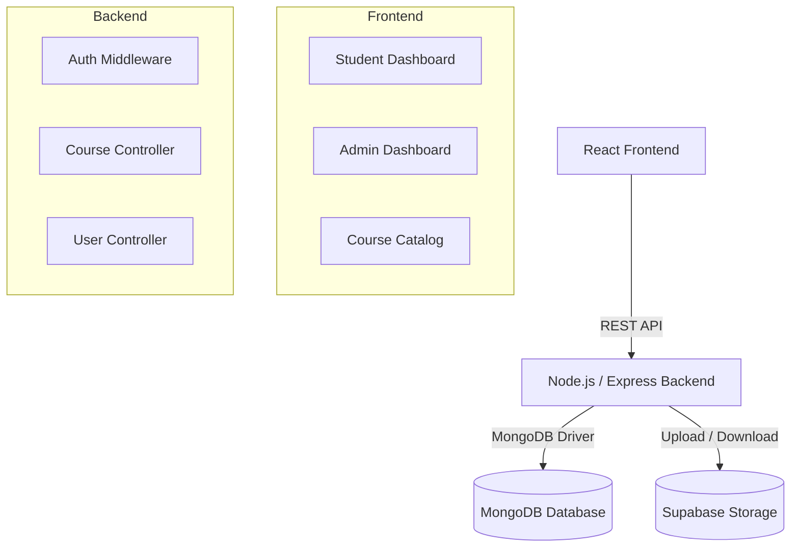

# EduTrack: Institutional Student Management System

EduTrack is a full-stack student management portal for academic institutions. It gives administrators course, student, announcement, and resource-management tools while students can browse courses, enroll, upload documents, and track progress.

## Features

- **Role-Based Access Control:** Admin and student dashboards with JWT-protected routes.
- **Course Catalog & Enrollment:** Students browse and enroll; admins manage the catalog.
- **Resource Management:** Admins upload course materials and messages through Supabase Storage.
- **Announcements:** Admins can broadcast institutional updates.
- **Progress Tracking:** Students can update academic progress from their dashboard.
- **MongoDB Database:** App data is stored in MongoDB collections with startup-managed indexes.

## Architecture



## Technology Stack

- **Frontend:** React, Vite, React Router, Tailwind CSS, Context API.
- **Backend:** Node.js, Express, jsonwebtoken, multer, cors.
- **Database:** MongoDB with the official Node.js driver.
- **File Storage:** Supabase Storage.

## Local Setup

### Prerequisites

- Node.js 22+
- MongoDB running locally or a MongoDB Atlas connection string
- Supabase account for file storage

### Backend

```bash
cd backend
npm install
```

Create `backend/.env` using `backend/.env.example` as a guide:

```env
PORT=5000
MONGODB_URI=mongodb://127.0.0.1:27017/edutrack
MONGODB_DB_NAME=edutrack
JWT_SECRET=your_super_secret_jwt_key
JWT_EXPIRES_IN=24h
FRONTEND_ORIGIN=http://localhost:5173
SUPABASE_URL=your_supabase_project_url
SUPABASE_SERVICE_ROLE_KEY=your_supabase_service_role_key
SUPABASE_STORAGE_BUCKET=student-files
```

Initialize MongoDB seed data and indexes:

```bash
npm run db:init
```

Start the backend:

```bash
npm run dev
```

Default seeded admin login:

```text
admin@edutrack.edu / admin123
```

### Frontend

```bash
cd frontend
npm install
```

Create `frontend/.env`:

```env
VITE_API_URL=http://localhost:5000/api
```

Start the frontend:

```bash
npm run dev
```

## Security Notes

- JWTs protect authenticated routes and role-specific actions.
- Passwords are hashed with bcrypt.
- MongoDB unique indexes enforce duplicate-safe emails and enrollments.
- File uploads validate MIME type and size before sending files to Supabase Storage.

## License

This project is proprietary software designed for institutional use.
